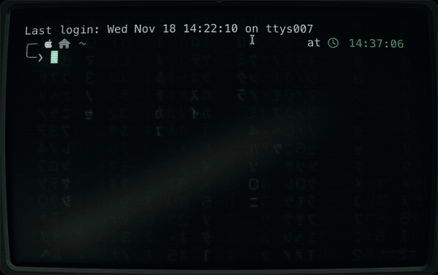

# Ghostty Stylized Effects

A collection of stylized visual effects for Ghostty. Matrix-style rain is one option, joined by typing heat, screen shake, sparks, glass glare, lighting presets, and a terminal bezel. The Zsh integration sends cursor color updates to the shader and stores toggle state per terminal.



## Install

Run `./install.sh` to add this project's Ghostty config to the Ghostty configuration file. The installer writes a generated config with absolute paths for the shader and `launch-shell`. Open a new Ghostty window after installation.

The installer derives paths from its own location, so the project can live in a different directory. It updates the generated config on each run. The `install.sh` script adds the initial config loader to Ghostty; no project path needs to be added to the user's `.zshrc`.
## Record a demo

Run the startup replay and capture workflow from a terminal:

```sh
scripts/record-demo.sh
```

It hides existing Ghostty windows, then opens the demo in a 54×16 window with isolated effect state and a hidden titlebar. It captures only that window, then replays `shell.txt` and creates `assets/ghostty-startup.mov` and `assets/ghostty-startup.gif`. The GIF is 540 pixels wide, 20 fps, limited to 32 colors, and plays at 2× speed. The demo toggles rain, sparks, glass glare, and the bezel separately, cycles through the lighting presets, and ends with the full effect stack restored. Ordinary lines are typed and submitted to the shell. Lines such as `#cmd+shift+o` toggle an effect without appearing as text, `sleep N` lines add recording delays without being typed, and lines beginning with `###` are comments and are skipped. Review `shell.txt` before running: ordinary lines execute as shell commands.

On first use, macOS may ask the terminal app for Screen Recording and Accessibility access. To leave more time between commands, pass `--pause 2.5`. To convert an existing recording without launching Ghostty, use `scripts/make-demo-gif.sh INPUT.mov OUTPUT.gif`.

## Controls

| Shortcut | Effect |
| --- | --- |
| `Cmd+Shift+P` | Toggle the Matrix rain effect |
| `Cmd+Shift+B` | Toggle background rain |
| `Cmd+Shift+I` | Toggle idle animation |
| `Cmd+Shift+S` | Toggle screen shake |
| `Cmd+Shift+K` | Toggle sparks |
| `Cmd+Shift+G` | Toggle the glass glare |
| `Cmd+Shift+O` | Cycle daylight, dawn/dusk, and midnight lighting |
| `Cmd+Shift+V` | Toggle the bezel |

Toggle state is saved per terminal under `${XDG_STATE_HOME:-~/.local/state}/matrix-power/`.

## Files

- `config` — Ghostty appearance, shader, and key bindings
- `shaders/matrix-power.glsl` — shader for the Matrix rain and companion visual effects
- `shell/heat.zsh` — typing heat and toggle integration
- `shell.txt` — demo commands and shortcut cues for the recording script
- `bin/` — terminal effect commands
- `install.sh` — adds the config loader to Ghostty's config
- `scripts/record-demo.sh` — launches Ghostty, replays the demo, and captures it
- `scripts/make-demo-gif.sh` — converts a screen recording to a looping GIF
